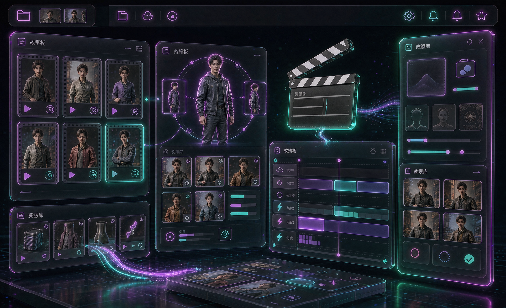

# 烬序 JINSU — AI 短剧创作工作台（美嘉拓旗下 · 开源版）

[](./LICENSE)
[](./README.md#本地优先)
[](https://react.dev)
[](https://vitejs.dev)
[](https://jinsuai.github.io/shortdrama/)

> 纯浏览器、本地优先的 AI 短剧全流程工作台：资产管理 → 分镜剧本 → 批量生成 → 导出，一条龙。
> 调用你自己的模型（本地 Ollama / vLLM 或任意 OpenAI 兼容 API），不绑平台、数据不出本机。



「烬序 JINSU」是美嘉拓旗下、面向竖屏短剧创作的 **纯浏览器** AI 全流程工作台：从剧本出发，完成分集剧本、实体设定、
分镜拆分、分镜生图、角色管理、AI 配音、视频生成、剪辑成片到导出的完整链路。

## 特性

- **纯 Web 应用**：不依赖任何桌面壳，浏览器打开即用。
- **直连模型 API**：文本 / 图片 / 视频 / 配音 / 音乐 / 3D 全部由用户自行配置，
  不经过任何中间服务端。
- **本地优先**：项目、素材、生成结果默认只保存在本机浏览器存储中。
- **无账户体系**：不需要登录、没有会员与积分。

## 快速开始

```bash
npm install
npm run dev      # 开发预览
npm run build    # 生产构建，产物在 dist/
npm run preview  # 预览构建产物
```

## 配置模型 API（必做）

开源版不内置任何模型服务。首次使用请打开 **设置 → 模型配置**，按模态填写：

| 模态 | 用途 |
| --- | --- |
| 文本 | 剧本生成、分镜拆分、提示词润色 |
| 图片 | 分镜生图、角色设定图 |
| 视频 | 图生视频 / 文生视频 |
| 配音 | TTS 语音合成 |
| 音乐 | 背景音乐生成 |
| 3D | 三维模型生成 |

每项需填 `Base URL`、`API Key`、`模型名`，接口遵循 OpenAI 兼容协议。
未配置时提交生成会给出明确提示。

### 可选：自建后端

少数能力（服务端抽帧、服务端合并导出）需要自建后端。若已部署，可在
**设置 → 模型配置** 中填写「后端服务地址」，或直接在浏览器控制台执行：

```js
localStorage.setItem('BACKEND_BASE_URL', 'https://your-backend.example.com')
```

未配置时这些功能不可用，其余能力不受影响。

## 目录结构

```
src/
  components/Studio/     # 主界面（外壳、工作区、流水线各步骤、设置）
  components/NewScript/  # 旧版短剧流程组件
  lib/providers/         # 统一模型接入层（按模态调用 OpenAI 兼容接口）
  lib/                   # 提示词模板、分镜、媒体工作流、ffmpeg 封装等
local-packages/          # 本地依赖包（ui / agnes-client / glm-client）
```

## 许可证与商业授权

本仓库采用 **「AGPL-3.0 免费 + 商业许可付费」双许可** 模式：

- **非商业用途**（个人学习、开源研究、非营利用途等）：依据
  [AGPL-3.0](./LICENSE) 免费使用，须遵守其全部条款
  （含：以网络服务形式提供时，须向用户提供其修改后源代码的义务）。
- **商业用途**（SaaS / 网络服务分发、闭源集成、企业内收费工具、
  以营利为目的的再分发等）：须另行购买商业许可，详见
  [COMMERCIAL-LICENSE.md](./COMMERCIAL-LICENSE.md)。
  **未购买商业许可之前，任何商业使用均构成侵权。**

商业授权咨询：529422804@qq.com

## 反馈与交流

遇到问题、想提意见、想加功能，随时找我：

- 提 [Issue](https://github.com/jinsuai/shortdrama/issues) — 流程清楚，方便追溯；
- 加微信直接说 — 配置搭不起来、某个模型接不上、界面哪里不好用，
  直接发截图，比打字描述快得多：


## 说明

- 界面文案与交互为本项目自有实现。
- 生成质量与费用取决于你所配置的模型服务，本项目不对第三方服务负责。
